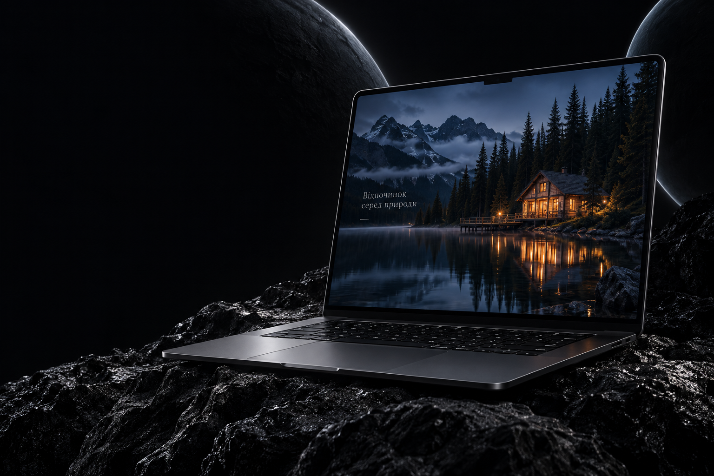

<div align="center">

# NX · NAZARCHUK

### Digital Design & Development

Дизайн, який привертає увагу. Сайти, які працюють на результат.

[](https://gtbebik2011-code.github.io/nazarchuk-digital/)
[](https://t.me/S2A0N1E0K)



**[Сайт](https://gtbebik2011-code.github.io/nazarchuk-digital/) · [Портфоліо](https://gtbebik2011-code.github.io/nazarchuk-digital/#projects) · [Контакти](https://gtbebik2011-code.github.io/nazarchuk-digital/#contact)**

</div>

## Про проєкт

Персональний сайт-портфоліо **Nazarchuk — Digital Design & Development**. Монограма NX, графітова палітра, сріблясті відблиски та великі зображення формують цілісний візуальний стиль.

Від першого знайомства до обговорення ідеї: сайт презентує послуги, демонструє роботи й дає змогу зв’язатися напряму.

## Що всередині

- Адаптивна верстка для комп’ютерів, планшетів і телефонів.
- Портфоліо з фільтрами за напрямами та прямими посиланнями на роботи.
- Розділи про дизайн, розробку, інтернет-магазини та підтримку.
- Чотири етапи роботи: бриф → дизайн → розробка → запуск.
- Мобільне меню, клавіатурна навігація та підтримка зменшеного руху.
- Локальні зображення й шрифти без залежності від сторонніх CDN.
- Прямий зв’язок через Telegram і телефон.

## Вибрані роботи

| Проєкт | Напрям | Переглянути |
| --- | --- | --- |
| **Forest Whispers** | Відпочинок серед природи | [Відкрити сайт ↗](https://gtbebik2011-code.github.io/Forest-Whispers/) |
| **Car Time 87** | Автодетейлінг | [Відкрити сайт ↗](https://gtbebik2011-code.github.io/car-time87/) |
| **EverCraft** | Вироби з епоксидної смоли | [Відкрити сайт ↗](https://smolanazarcuk.com) |

## Технології

**HTML5 · CSS3 · JavaScript · Node.js · GitHub Pages**

Сайт статичний: без фреймворків, встановлення залежностей і етапу збірки. Node.js потрібен лише для локального перегляду.

## Локальний запуск

Встановіть Node.js, потім виконайте:

```bash
git clone https://github.com/gtbebik2011-code/nazarchuk-digital.git
cd nazarchuk-digital
npm run dev
```

Відкрийте **http://127.0.0.1:4178**.

Перевірка синтаксису JavaScript:

```bash
npm run check
```

## Структура

```text
docs/
├── index.html       # Розділи, тексти та посилання
├── style.css        # Основний дизайн і адаптивність
├── contact.css      # Контактний блок
├── app.js           # Меню, фільтри та перегляд айдентики
└── assets/          # Зображення, логотип і шрифти
server.mjs           # Локальний HTTP-сервер
package.json         # Команди запуску та перевірки
```

GitHub Pages публікує папку **`docs/`** з гілки **`main`**. Зміни в цій папці з’являються на сайті після наступного успішного розгортання Pages.

## Контакти

**Маєте ідею? Створимо її разом.**

- Telegram: [@S2A0N1E0K](https://t.me/S2A0N1E0K)
- Телефон: **+380 98 349 07 80**

<div align="center">

---

**NAZARCHUK · FROM IDEA TO REALITY**

</div>
